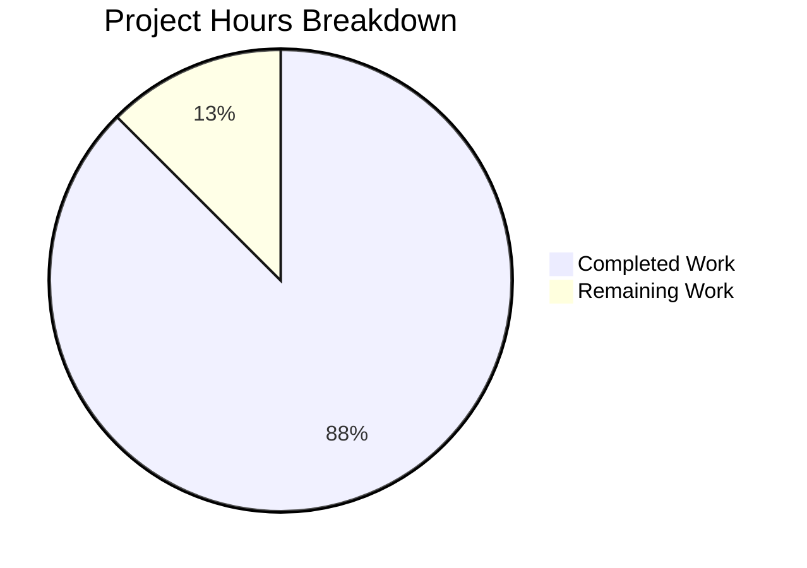

# 1. Executive Summary

## 1.1 Project Overview

`Welcome.py` is a single-file Python command-line program at the repository root. Run as `python Welcome.py`, it writes one line — `Welcome to Blitzy` — to standard output, ends it with one newline, writes nothing to standard error, ignores any arguments and exits `0`. Its audience is a developer or automated job checking that a Python toolchain works, and a stakeholder reading the line as confirmation. There is no library, service, state, configuration, dependency, integration or user interface: the product's only surface is its 18 bytes of standard output.

## 1.2 Completion Status

**87.5% complete — 10.5 hours of a 12.0-hour scope delivered.**



Completed work is shown in Dark Blue (#5B39F3); remaining work is shown in White (#FFFFFF).

| Metric | Hours |
|--------|-------|
| Total Hours | 12.0 |
| Completed Hours (AI + Manual) | 10.5 |
| Remaining Hours | 1.5 |

Calculation: completed hours 10.5 ÷ (completed 10.5 + remaining 1.5) = **87.5%**.

## 1.3 Key Accomplishments

- [x] Prints `Welcome to Blitzy` once — 18 bytes, byte-exact, digest verified.
- [x] Ends the line with exactly one newline; no carriage return or trailing blank line.
- [x] Exits `0` with an empty standard error on pipe, file and null sinks.
- [x] Ignores every argument shape, including option-looking and injection-shaped ones.
- [x] One statement, zero imports, one code line — the entire product.
- [x] Exactly one added path, `Welcome.py` at the repository root.
- [x] Identical output under empty and hostile environments and seven interpreter flags.
- [x] Deterministic and inert: concurrent runs yield one digest and no run touches the tree.

## 1.4 Critical Unresolved Issues

**2 of 24 AAP-scoped requirements remain open, both partially complete** — verification not yet executed on runtimes this environment lacks. Nothing blocks release.

| Issue | Impact | Owner | ETA |
|-------|--------|-------|-----|
| Portability verification at the Python 3.8 floor and on the 3.15 release has not been executed | The compatibility claim rests on the language subset used and the unchanged `print` contract rather than on a run | Release engineering | 0.5 day |
| Release acceptance evidence has not been captured on the interpreter the target environment provides | The release record carries evidence from CPython 3.13.7 rather than from the deployment runtime | Release engineering | 1 day |

## 1.5 Access Issues

| System/Resource | Type of Access | Issue Description | Resolution Status | Owner |
|-----------------|----------------|-------------------|-------------------|-------|
| Python 3.8 and Python 3.15 interpreters | Version-specific runtime for compatibility validation | Neither interpreter is installed in this environment, and installing or replacing the shared interpreter is out of scope for this work | Open — no action required for the delivered code; needed only before the endpoint compatibility runs can be executed | Release engineering |

No other access issues exist: the product needs no credentials, secrets, services or network access.

## 1.6 Recommended Next Steps

1. **[High]** Run the acceptance battery on Python 3.8 and 3.15, using copies held outside the checkout (0.5 h).
2. **[High]** Keep `Welcome.py` byte-exact; re-run the byte and source-shape checks after any edit.
3. **[Medium]** Capture the release acceptance evidence on the deployment interpreter (1.0 h).
4. **[Medium]** Adopt the command battery in Section 9 as the release gate.
5. **[Low]** Revisit the runtime floor if the file ever gains a security obligation.

# 2. Project Hours Breakdown

## 2.1 Completed Work Detail

| Component | Hours | Description |
|-----------|-------|-------------|
| Greeting output and line termination | 2.5 | The product in full: one call to the builtin with the inline ASCII literal, no keyword arguments, the greeting printed once and terminated by exactly one newline, giving 18 bytes on standard output with digest `2dc7e85a734de043468d7beb8ee5294e0c04440f23fd89b69fd8ea0ee7971951` (`Welcome.py:1`) |
| Clean exit, stream hygiene and argument indifference | 1.5 | Exit status `0` with zero bytes on standard error on every ordinary invocation; every argument shape ignored, with no usage text; the run is inert on pipe, regular-file and null sinks |
| Source shape and content rules | 2.0 | One statement, zero imports, one code line, no comment or docstring, PEP 8 line shape, capital-W file name at the repository root, no shebang line, no executable bit, no encoding declaration |
| Tree, exclusions and delivery hygiene | 1.5 | Exactly one added path at the repository root; every excluded artefact class confirmed absent; no side-effect files or bytecode anywhere in the tree; the pre-existing `README.md` left byte-identical |
| Portability across Python 3.8–3.15 | 1.0 | No version-conditional construct, nothing newer than 3.8, no import and ASCII-only output, validated on the environment's CPython 3.13.7 (1.0 of an estimated 1.5 hours; the endpoint runs remain open) |
| Security-surface absence and the single-write constraint | 0.5 | Confirms the deliverable reads and holds nothing — no input, file, environment variable, network resource, credential or dependency — and performs one 18-byte write |
| Acceptance evidence | 1.5 | Compile gate on a copy outside the checkout, byte-exact comparison, byte count, digest, stream sizes, exit statuses, argument shapes, environment and locale matrix, determinism, concurrency, and the negative and malformed-copy controls (1.5 of an estimated 2.0 hours) |
| **Total** | **10.5** | Matches Completed Hours in Section 1.2 |

## 2.2 Remaining Work Detail

| Category | Hours | Priority |
|----------|-------|----------|
| Portability verification on the Python 3.8 floor and on the 3.15 release: obtain each interpreter and run the syntax gate and the byte-exact comparison against copies of `Welcome.py` held outside the checkout | 0.5 | High |
| Release acceptance evidence on the target environment's interpreter: run the acceptance battery there and record its outputs with the release | 1.0 | Medium |
| **Total** | **1.5** | Matches Remaining Hours in Section 1.2 |

Remaining work is verification only: no code change is outstanding, and no capability is missing. Completed 10.5 hours + remaining 1.5 hours = 12.0 total hours; 10.5 ÷ 12.0 = 87.5% complete.

# 3. Test Results

The project carries no test framework, no CI configuration and no coverage instrumentation — the deliverable is one statement, and the request excludes test artefacts. Verification is therefore a command-level acceptance battery, executed against the delivered file from the repository root with all transient output kept outside the checkout. The counts below are checks that were executed, not files inspected.

| Area / Category | Framework | Tests | Passed | Failed | Coverage | What This Proves |
|-----------------|-----------|-------|--------|--------|----------|------------------|
| Greeting bytes, line termination and digest | POSIX shell: `cmp`, `od`, `wc`, `sha256sum` | 7 | 7 | 0 | n/a — no instrumented suite exists | Standard output is exactly the 17 greeting characters followed by one newline — 18 bytes, byte-identical to the expected bytes, under digest `2dc7e85a…1951`, arriving whole through a block-buffered pipe |
| Argument indifference | POSIX shell | 17 | 17 | 0 | n/a | Any argument leaves output, standard error and exit status unchanged — option-looking flags, an empty string, unicode, shell metacharacters, command-substitution text, injection-shaped payloads, a path-traversal string and 200 arguments at once, with no usage text ever emitted |
| Environment, locale and encoding independence | POSIX shell; interpreter flags | 14 | 14 | 0 | n/a | The same 18 bytes appear under a fully stripped environment, a hostile environment, three locales (`C`, `C.UTF-8`, `POSIX`), three output encodings (`ascii`, `utf-8`, `latin-1`) and seven interpreter flags including `-I`, `-S`, `-X dev` and `-W error` |
| Syntax gate and source-shape conformance | CPython `py_compile` and `ast`; shell greps | 14 | 14 | 0 | n/a | The file compiles cleanly on a copy outside the checkout; it is one top-level statement, one code line, zero imports, no comment or docstring, ASCII only, PEP 8-shaped, 27 bytes, mode 644, with no deferred-work marker |
| Tree, naming and source-control contract | `git` and `find` | 10 | 10 | 0 | n/a | Exactly one path was added at the repository root under the capital-W name, three case-variant controls fail as expected, `README.md` is byte-identical to the base commit, the working tree is clean and no bytecode exists |
| Sink variety and failure controls | POSIX shell | 7 | 7 | 0 | n/a | The greeting arrives on pipe, regular-file and null sinks; a 17-byte output fails the comparison with `EOF on …`; a malformed copy is rejected with the interpreter's own `SyntaxError` and status 1; absent interpreters produce the shell's own message and status 127 |
| Invocation-form and working-directory independence | POSIX shell | 6 | 6 | 0 | n/a | Standard input is never consumed (null, junk-carrying and closed) and the same 18 bytes appear from an unrelated working directory, through an absolute path and through a module-style invocation |
| Determinism, concurrency and delivery hygiene | POSIX shell; `git` | 3 | 3 | 0 | n/a | Repeated and 20-way concurrent runs produce one digest and zero bytes on standard error, and every probe leaves the tree unchanged |

**78 checks were executed, 78 passed and none failed.**

**Not Covered**

- **Execution on Python 3.8 and Python 3.15** — no interpreter for either version exists in this environment and installing one is out of scope, so both endpoint runs are unexercised at every level. A human should perform them before relying on the version range: copy `Welcome.py` outside the checkout and run the syntax gate and the byte-exact comparison under each interpreter.
- **The non-specified module-style invocation** (`python -m`) — its default bytecode placement writes `__pycache__/Welcome.cpython-313.pyc` beside the file, which the acceptance rules treat as an extra path. No acceptance criterion asserts it, and no permitted change can prevent it; automation should keep to the specified `python Welcome.py` invocation.
- **Broken-sink behaviour** — a consumer that never reads and an unwritable standard output were observed, not asserted: the interpreter ends with status 120 and its own message on standard error at the final flush, and a closed standard output makes it exit 0 with the greeting discarded. These follow from the interpreter, not from the file, and the request excludes the error handling that could mask them; a consumer that must be certain should compare the stdout bytes rather than gate on the status.
- **Anything beyond the process contract** — there is no user interface, screen, HTTP endpoint, data store, background worker or external service in this product, so no test of that kind exists to run or is specified.
- **Automated regression detection** — with no test framework or CI in the tree by design, nothing runs automatically when the file changes. The command battery in Section 9 is the substitute and should be run after any edit.

# 4. Runtime Validation & UI Verification

The product has no screen, no browser surface, no HTTP endpoint, no data store and no external integration: its whole runtime surface is one process that writes 18 bytes to file descriptor 1 and exits. Runtime validation is therefore process-level, and the evidence is byte-level — captured standard output, its digest, stream sizes and exit statuses rather than screenshots.

- ✅ **Startup and invocation from the repository root** — `python Welcome.py` writes the 18-byte line, exits `0` and leaves standard error empty; the run costs 13 ms, identical to a bare interpreter start-up.
- ✅ **Greeting delivery across sinks** — pipe, regular file and `/dev/null`; a piped reader receives the whole line with no `-u`, no `flush=True` and no `PYTHONUNBUFFERED`, under both the bash and the portable `sh` comparison.
- ✅ **Argument handling** — 17 argument shapes ignored, from option-looking flags through unicode, shell metacharacters and injection-shaped payloads to 200 arguments at once; no usage or version text exists on either stream.
- ✅ **Environment, locale and encoding independence** — identical bytes under a fully stripped environment, hostile variables, three locales, three output encodings and seven interpreter flags, with no warning raised even when warnings are errors.
- ✅ **Determinism and concurrency** — five sequential runs yield one digest; twenty parallel invocations yield 20/20 byte-identical output and zero bytes on standard error.
- ✅ **Tree inertness** — no run creates or modifies a path: no bytecode, no log, no temporary file, and the pre-existing `README.md` stays byte-identical.
- ✅ **Interpreter-side failure surfacing** — a malformed copy exits `1` with the interpreter's own `SyntaxError` and no standard output; an absent interpreter yields the shell's own message and status `127`.
- ⚠ **A consumer that never reads, or an unwritable sink** — the interpreter ends with status `120` and its own `BrokenPipeError`/`OSError` text at the final flush, deterministically. The exit status is not a product-failure signal in this case, and the design deliberately carries no error handling that could mask it.
- ⚠ **Closed standard output** — exit `0` with the greeting discarded, because the interpreter has no `sys.stdout` in that case; a caller that must be certain should compare the captured bytes rather than gate on the status.
- ⚠ **Never exercised at runtime** — execution on Python 3.8 and Python 3.15, and the non-specified module-style invocation, whose default bytecode placement writes `__pycache__` beside the file.

No endpoint, external service, credential or configuration was exercised because none exists in this product; there is no integration surface to drive and no UI to verify.

# 5. Compliance & Quality Review

## 5.1 Compliance Matrix

| Deliverable / Requirement | Status | Progress | Evidence |
|---------------------------|--------|----------|----------|
| Greeting printed exactly once | ✅ Pass | 100% | One call to the builtin whose sole argument is the inline literal (`Welcome.py:1`); the run emits the line once |
| Line terminated by exactly one newline | ✅ Pass | 100% | No keyword arguments on the call; 18 bytes ending `0x0a`; exactly one newline counted through a pipe; no carriage return |
| Clean exit with an empty standard error | ✅ Pass | 100% | Exit `0` and zero stderr bytes on every ordinary invocation; no exception construct exists in the source |
| Extra command-line arguments ignored | ✅ Pass | 100% | 17 argument shapes leave output, stderr and status unchanged; no usage text; no reference to `sys.argv` |
| Byte-exact, encoding-independent output | ✅ Pass | 100% | Byte comparison exits `0`; 18 bytes; digest `2dc7e85a…1951`; ASCII-only literal |
| Pipe-safe delivery with no flush flag | ✅ Pass | 100% | The whole line arrives through a block-buffered pipe under both the bash and the portable `sh` comparison |
| No side-effect files | ✅ Pass | 100% | No run creates or modifies a path; no bytecode, log or temporary file anywhere in the tree |
| Simplicity: one statement, zero imports, within the code-line ceiling | ✅ Pass | 100% | One code line, one physical line, no import, function, class or `__main__` guard |
| No security surface | ✅ Pass | 100% | Nothing is read or held — no input, file, environment variable, network resource, credential or dependency; the supplied secret is unreferenced |
| File name, location and delivered tree | ✅ Pass | 100% | Capital-W `Welcome.py` at the repository root; exactly one added path; every excluded artefact class absent |
| Deterministic output on every run | ✅ Pass | 100% | One digest across locales, output encodings, empty and hostile environments, interpreter flags and 20-way concurrency |
| Portability across Python 3.8–3.15 | ⚠ Partial | 60% | Verified on the environment's CPython 3.13.7, which sits inside the floor; the 3.8 and 3.15 endpoint runs are unperformed |

## 5.2 AAP & Rule Divergences and Gaps

| What the AAP/Rule Required | What Was Delivered Instead | Why It Diverged | Impact | Remediation |
|----------------------------|----------------------------|-----------------|--------|-------------|
| Verification on the CPython 3.12.3 runtime recorded in the plan | Executed and validated on the environment's CPython 3.13.7 | The interpreter installed in this environment is 3.13.7; replacing or downgrading a shared interpreter is out of scope, and the stated floor is "Python 3.8 or later", which it satisfies | None to the artefact: no code byte, output byte or expected value changes | None required. Record CPython 3.13.7 as the validated runtime |
| A repository holding exactly one file, created in an otherwise empty working directory | The checkout tracks a pre-existing 42-byte `README.md` (`b5d0683`), which was left byte-identical; exactly one path was added by this work | The file pre-dated the work, and the plan declares nothing updated or deleted while the acceptance criterion counts only files the run adds | The "one file in the tree" statement is literally untrue; the requirement that this work add exactly one file is satisfied | None. Do not delete `README.md` to make the tree match the prose |
| Compile runs on the Python 3.8 floor and on the latest stable 3.15 | The syntax gate and the byte-exact acceptance battery were executed on CPython 3.13.7; neither endpoint run was performed | Neither interpreter exists in this environment and installing one is out of scope, so the runs are unperformable here | The stated version range rests on the language subset used (`print` over a literal), the absence of version-conditional code and ASCII-only output, not on a run | 0.5 h: obtain each interpreter, copy `Welcome.py` outside the checkout and run the syntax gate and the byte comparison under both |
| The deliverable recorded at a run-specific absolute path | Delivered at the repository root as `Welcome.py`, its binding location | The recorded path belongs to a different working copy; each working copy has its own root, and only the repository-relative path is binding | None | None required |
| PEP 8's convention that module names be lower case | `Welcome.py` with a capital W — **Sanctioned** | The user's explicit instruction names `Welcome.py`; the plan records that instruction as superseding the convention | On a case-sensitive filesystem the lower-case spelling is a different file, so the capital W is load-bearing | None. Retain the exact capitalisation in every copy, script and deployment step |

**Runtime version.** The plan recorded CPython 3.12.3 as the environment's interpreter; this environment provides 3.13.7 as `python`, `python3` and `python3.13`. Nothing in the deliverable depends on the version: `Welcome.py` carries no version-conditional code, imports nothing and emits an ASCII-only constant, so the accepted floor of Python 3.8 or later is met by the installed runtime and no output byte moves. The consequence is documentary — any release note or dashboard quoting 3.12.3 as the validated interpreter describes a runtime this project has not been exercised on. Record CPython 3.13.7 as the validated interpreter, and prefer it (or a newer release) for future validation so recorded and executed evidence agree.

**Repository tree premise.** The plan described a repository holding exactly one file, created in a working directory that was empty and not yet under version control. The checkout instead already tracked a 42-byte `README.md` at the base commit `b5d0683`. That file was deliberately left untouched: the plan's deliverable map declares nothing updated and nothing deleted, and the acceptance criterion counts only the files this work adds — it added exactly one, `Welcome.py`. The impact is confined to how one sentence reads: a reader comparing a literal "one file" expectation against a file listing will see two. Do not delete or edit `README.md` to reconcile the prose; treat the requirement as "exactly one file added", which the tree satisfies.

**Portability verification at the version range endpoints.** Acceptance called for the file to compile and run on the Python 3.8 floor and on the current stable release, 3.15. Neither interpreter exists in this environment — each yields the shell's own "command not found" with status 127 — and installing one is out of scope. What survives is a strong but inspection-based claim: the file is a single `print` call over an ASCII literal, uses no construct introduced after 3.8, branches on no version, and relies on `print`'s documented signature and newline termination, unchanged across 3.8–3.15. To close the item, install each interpreter in an isolated location, copy `Welcome.py` outside the checkout and run both checks there.

**Deliverable location.** The plan located the file with a run-specific absolute path that is not this working copy's root. The binding statement is the repository-root-relative one — `Welcome.py` with a capital W at the root — and the delivered file satisfies it exactly; nothing else was added. No action follows, but anyone wiring a deployment step should reference the file relative to the repository root rather than copying a path out of the plan, and should not go looking for the recorded location on their own disk.

**Capital-W file name over PEP 8.** PEP 8 conventionally lower-cases module names, which would suggest `welcome.py`; the file is `Welcome.py`. This is sanctioned: the user's explicit instruction named the file, and the plan records that the instruction wins. On this case-sensitive filesystem the two spellings are different files — the lower-case control fails with the interpreter's own "can't open file" message and status 2, which is precisely the protection the capital W provides. Keep the capitalisation intact in every copy, container layer, archive, scheduled job or pipeline that references the file; a lower-case rename anywhere would silently turn a working invocation into a missing-file failure.

# 6. Risk Assessment

| Risk | Category | Severity | Probability | Mitigation | Status |
|------|----------|----------|-------------|------------|--------|
| Portability at the version range endpoints is proven by inspecting the language subset rather than by executing the file there | Technical | Medium | Low | Run the syntax gate and the byte comparison under isolated Python 3.8 and 3.15 interpreters; the file uses no construct newer than 3.8, branches on no version and emits an ASCII-only constant | Open — 0.5 h task |
| A future edit breaks the tightly specified shape: an added comment, docstring, import, `main()` guard, second `print` or extra file immediately fails the acceptance criteria | Technical | Medium | Medium | Treat the file as frozen; re-run the Section 9 battery after any change, in particular the byte comparison and the source-shape checks | Open — procedural |
| Consumer integration over file descriptor 1: with standard output closed the greeting is discarded and the process still exits `0`, and with an abandoned pipe or an unwritable sink the interpreter ends with status `120` and its own message on standard error | Integration | Medium | Low–Medium | Have the consumer compare the captured stdout bytes rather than gate on the exit status, and read at least one byte before closing a pipe; masking the interpreter's behaviour would require the error handling the request excludes | Open — documented interpreter behaviour |
| No test framework or CI exists in the tree by design, so a change is caught only by running the battery by hand | Operational | Medium | Medium | Run the Section 9 battery as the release gate and attach its outputs to the release record | Open — procedural |
| The non-specified module-style invocation (`python -m`) writes `__pycache__` beside the file, which the acceptance rules count as an extra path | Operational | Low | Low | Keep to the specified `python Welcome.py` invocation, or point the bytecode cache outside the checkout with `PYTHONPYCACHEPREFIX` | Open — no permitted in-repo fix |
| The stated runtime floor, Python 3.8, has been end of life since 7 October 2024 | Security | Low | Low | No security obligation exists today — the product reads no input, holds no data, carries no credential and depends on nothing — so raise the floor only if that ever changes | Accepted |
| Style conformance rests on inspection: no linter, formatter or type checker exists in this environment, and none may be added to a one-statement deliverable | Technical | Low | Low | A 27-byte file is reviewable by reading; hold any future change to the same review | Accepted |

No third-party, network, data-store or credential risk exists: the product integrates with nothing, opens no socket, holds no secret and reads no configuration, so its only integration surface is the standard-output stream described above. The single-write performance constraint carries no risk either — the run costs 13 ms, identical to bare interpreter start-up.

# 7. Visual Project Status


**87.5% complete** — 10.5 hours delivered of a 12.0-hour scope; Completed is Dark Blue (#5B39F3), Remaining is White (#FFFFFF).

**Remaining hours per category**

| Category | Hours |
|----------|-------|
| Python 3.8 and 3.15 endpoint verification | 0.5 |
| Release acceptance evidence on the target interpreter | 1.0 |
| **Total** | **1.5** |

**Remaining work by priority**

| Priority | Hours | Share of remaining work |
|----------|-------|-------------------------|
| High | 0.5 | 33% |
| Medium | 1.0 | 67% |
| Low | 0.0 | 0% |
| **Total** | **1.5** | **100%** |

**Delivered scope by capability**

| Capability | Status | Share of completed hours |
|------------|--------|--------------------------|
| Greeting output and line termination | Complete | 24% |
| Source shape and content rules | Complete | 19% |
| Clean exit, streams and argument handling | Complete | 14% |
| Tree, exclusions and delivery hygiene | Complete | 14% |
| Acceptance evidence | Complete | 14% |
| Portability across Python 3.8–3.15 | Partial (60%) | 10% |
| Security-surface absence and single-write constraint | Complete | 5% |

# 8. Summary & Recommendations

The project delivers one artefact: `Welcome.py` at the repository root, a 27-byte single-statement Python program that writes `Welcome to Blitzy` to standard output once, ends the line with exactly one newline, writes nothing to standard error, ignores every command-line argument and exits with status `0`. Twenty-two of the twenty-four scoped requirements are met in full and two are partially met, giving **87.5% completion** — 10.5 hours delivered of a 12.0-hour scope. Everything executable on the interpreter this environment provides has been executed and passes: the greeting and its terminator are byte-exact at 18 bytes under digest `2dc7e85a…1951`, the run is inert on pipe, file and null sinks, the source compiles, and the delivered tree is exactly one added file beside the untouched pre-existing `README.md`.

Verification was a 78-check acceptance battery run against the delivered file, all 78 passing, plus direct observation of the standard-output edge cases. It covered the byte contract and line termination, exit status and stream sizes, seventeen argument shapes, an environment and locale matrix, the syntax gate on a copy held outside the checkout, source-shape conformance (one code line, zero imports, no comment or docstring, PEP 8 line shape, capital-W name), the tree and source-control contract, determinism and concurrency, and the negative controls — a 17-byte output failing the byte comparison, a malformed copy exiting `1` with the interpreter's own `SyntaxError`, and absent interpreters answering with status `127`. That battery is the project's evidence, because the tree deliberately carries no test framework, no CI and no coverage instrumentation.

Two items remain open, both verification rather than code: the Python 3.8 floor and the 3.15 release runs were not performed, because neither interpreter exists in this environment and installing one is out of scope, and the release acceptance evidence still needs to be captured on the interpreter the target environment provides. The critical path to production is short and entirely procedural — 0.5 h for the endpoint runs and 1.0 h for the target-environment evidence, with no implementation, packaging or configuration work outstanding, since the product has no dependencies, no services and nothing to configure.

Production readiness: **ready for delivery exactly as specified**, with one caveat a release owner should accept knowingly — the portability statement across the whole version range rests on the language subset used, the absence of version-conditional code and the unchanged `print` contract rather than on an executed 3.8 or 3.15 run. Success metrics are unambiguous and already met on the validating runtime: 18 bytes on standard output on every invocation, an empty standard error, exit status `0`, one digest across every environment tested, and a clean tree after all probes.

The recommended next step is the high-priority endpoint verification, followed by recording the battery's outputs as the release gate for this artefact. Beyond that, treat `Welcome.py` as frozen: its shape *is* the specification, so any added comment, import, function or neighbouring file would break the acceptance criteria it currently satisfies. Section 9 gives the exact commands to reproduce every result in this guide.

# 9. Development Guide

## System Prerequisites

- A CPython interpreter, version 3.8 or later. This environment provides **CPython 3.13.7**, reachable as `python`, `python3` and `python3.13`.
- `bash` for the process-substitution comparison below; a portable `sh`/`dash` equivalent is given for environments without bash.
- Nothing else. There is no build tool, package manager, container runtime, database, cache, message broker or browser surface in this project.

```bash
python --version        # expected: Python 3.13.7
```

## Environment Setup

None is required. The project has no virtual environment, no configuration file and no environment variables: `Welcome.py` reads nothing from the environment and no code path looks one up. The only optional setting is the bytecode cache location, useful only if you invoke the file as a module rather than as a script:

```bash
export PYTHONPYCACHEPREFIX="$HOME/.cache/welcome-pycache"
```

## Dependency Installation

None. The file imports nothing — it calls the builtin `print` over a string literal — so there is no manifest, no lock file and no `pip install` step. The project runs on a bare interpreter.

## Application Startup

Run from the repository root. There is no service to start, no port to bind and no startup order.

```bash
python Welcome.py
```

Expected output — one line only, followed by your shell prompt:

```text
Welcome to Blitzy
```

Exit status `0`, nothing on standard error. The same result comes from `python3 Welcome.py` and, from any directory, from an absolute or relative path to the file.

## Verification Steps

**1. Syntax gate.** Compile a copy outside the checkout, so no `__pycache__` is written into the tree:

```bash
C=$(mktemp -d); cp Welcome.py "$C/"; (cd "$C" && python -m py_compile Welcome.py); echo "exit=$?"; rm -rf "$C"
# expected: exit=0   (no output from py_compile itself)
```

**2. Byte-exact output (bash).** This is the decisive check — it compares the real bytes, including the trailing newline:

```bash
bash -c 'python Welcome.py | cmp - <(printf "Welcome to Blitzy\n")'; echo "exit=$?"
# expected: exit=0 and no other output
```

**3. Byte-exact output (portable, no process substitution).**

```bash
E=$(mktemp); printf 'Welcome to Blitzy\n' > "$E"; python Welcome.py > "$E.actual"; cmp "$E" "$E.actual"; echo "exit=$?"
# expected: exit=0 and no other output
```

**4. Size, digest and byte rendering.**

```bash
python Welcome.py | wc -c
# expected: 18
python Welcome.py | sha256sum
# expected: 2dc7e85a734de043468d7beb8ee5294e0c04440f23fd89b69fd8ea0ee7971951  -
python Welcome.py | od -An -c
# expected:    W   e   l   c   o   m   e       t   o       B   l   i   t   z   y  \n
```

**5. Stream hygiene and exit status.**

```bash
O=$(mktemp); E2=$(mktemp); python Welcome.py > "$O" 2> "$E2"; echo "exit=$? stdout=$(wc -c < "$O") stderr=$(wc -c < "$E2")"
# expected: exit=0 stdout=18 stderr=0
```

**6. Argument indifference.**

```bash
python Welcome.py extra args; echo "exit=$?"
# expected: the greeting once, then exit=0 — no usage or version text
```

**7. Negative control.** Confirm the comparison can actually fail; a 17-byte output must be rejected:

```bash
printf 'Welcome to Blitzy' | cmp - <(python Welcome.py); echo "exit=$?"
# expected: cmp: EOF on - after byte 17, in line 1
#           exit=1
```

**8. Release gate.** Run steps 1–7 after any change to the file, and confirm the tree is still exactly one added path:

```bash
git status --porcelain -uall          # expected: no output
git diff --name-status <base>..HEAD   # expected: A   Welcome.py
```

## Example Usage

A first-run smoke check that a Python toolchain is present and that this file behaves as specified:

```bash
python Welcome.py && echo "toolchain OK"
```

Consuming the output in a pipeline — the whole line arrives without any flush flag:

```bash
python Welcome.py | cmp - <(printf 'Welcome to Blitzy\n') && echo "greeting verified"
```

Checking the greeting inside a larger script by comparing bytes rather than by trusting the exit status:

```bash
if printf 'Welcome to Blitzy\n' | cmp -s - <(python Welcome.py); then echo "exact"; else echo "mismatch"; fi
```

## Troubleshooting

| Symptom | Cause | Resolution |
|---------|-------|------------|
| `sh: 1: Syntax error: "(" unexpected`, exit `2` | Process substitution `<(...)` is a bash extension and the shell in use is `dash` | Run the comparison under `bash`, or use the portable two-file form in step 3 |
| A comparison "passes" even when the newline is missing | `$( … )` command substitution strips trailing newlines, so an equality test is vacuous | Never use `[ "$(python Welcome.py)" = "Welcome to Blitzy" ]` as evidence; always compare bytes with `cmp` |
| `__pycache__` appears beside the file | The file was run as a module (`python -m …`), which imports and caches it; a plain `python Welcome.py` never caches a `__main__` script | Delete the directory, keep to the specified invocation, and set `PYTHONPYCACHEPREFIX` outside the checkout if the module form is needed |
| `can't open file '…/welcome.py': [Errno 2] No such file or directory`, status `2` | The file name was spelled with a lower-case `w` (or another case variant) on a case-sensitive filesystem | Use the exact name `Welcome.py` with a capital `W` |
| Status `120` with `Exception ignored on flushing sys.stdout:` and `BrokenPipeError` or `OSError: [Errno 28]` | The consumer closed the pipe before reading, or the sink could not be written (`/dev/full`) | This is the interpreter's final-flush behaviour, not the script's; read from the pipe before closing it, or compare the captured stdout bytes |
| Exit `0` but nothing was printed | Standard output was closed when the process started (`>&-`), so the interpreter had no `sys.stdout` | Do not gate on the exit status alone; capture stdout and compare its bytes |
| `python3.8: command not found` (or `python3.15`), status `127` | That interpreter is not installed in this environment | Install the interpreter you need in an isolated location, then re-run steps 1–3 against a copy of the file |

The file is deliberately shaped so that no other failures are possible: it reads no input, file, environment variable or network resource, writes no file, holds no state and carries no error handling of its own.

# 10. Appendices

The project binds no network port and reads no environment variable, so the port and environment-variable appendices have no content to carry and are omitted.

## A. Command Reference

| Command (run from the repository root) | Purpose | Expected result |
|----------------------------------------|---------|-----------------|
| `python --version` | Confirm the interpreter in use | `Python 3.13.7` |
| `python Welcome.py` | Run the product | `Welcome to Blitzy`, exit `0`, empty standard error |
| `python3 Welcome.py`, `python3.13 Welcome.py` | Alternate interpreter names | Identical output and status |
| `C=$(mktemp -d); cp Welcome.py "$C/"; (cd "$C" && python -m py_compile Welcome.py); echo "exit=$?"; rm -rf "$C"` | Syntax gate without writing bytecode into the checkout | `exit=0`, no other output |
| `bash -c 'python Welcome.py \| cmp - <(printf "Welcome to Blitzy\n")'` | Byte-exact output verification (bash) | exit `0`, no output |
| `E=$(mktemp); printf 'Welcome to Blitzy\n' > "$E"; python Welcome.py > "$E.actual"; cmp "$E" "$E.actual"` | Byte-exact verification without process substitution | exit `0`, no output |
| `python Welcome.py \| wc -c` | Output size | `18` |
| `python Welcome.py \| sha256sum` | Output digest | `2dc7e85a734de043468d7beb8ee5294e0c04440f23fd89b69fd8ea0ee7971951  -` |
| `python Welcome.py \| od -An -c` | Byte-level rendering | `W e l c o m e   t o   B l i t z y \n` |
| `python Welcome.py extra args` | Argument indifference | The greeting once, exit `0` |
| `printf 'Welcome to Blitzy' \| cmp - <(python Welcome.py)` | Negative control | `cmp: EOF on - after byte 17, in line 1`, exit `1` |
| `git status --porcelain -uall` | Confirm nothing was added or modified | No output |
| `git diff --name-status <base>..HEAD` | Confirm the delivered path set | `A   Welcome.py` |

## C. Key File Locations

| Path | Role |
|------|------|
| `Welcome.py` | The product in full: one statement, 27 bytes, mode `644`, at the repository root |
| `README.md` | Pre-existing repository boilerplate (42 bytes); not product code and not modified by this work |

## D. Technology Versions

| Component | Version | Notes |
|-----------|---------|-------|
| Python runtime (validated) | CPython 3.13.7 | Installed as `python`, `python3` and `python3.13`; inside the project's stated floor |
| Python supported floor | 3.8 or later | The compatibility target; Python 3.8 reached end of life on 7 October 2024 |
| Python release named as current stable | 3.15.0 | Not installed in this environment, so not exercised |
| Dependencies | none | The file imports nothing; no manifest, lock file or virtual environment exists |
| Build, packaging and test tooling | none | An interpreted single script: nothing to build, package or install |

## F. Developer Tools Guide

- **Interpreter** — `python`, `python3` or `python3.13` (all CPython 3.13.7). No other interpreter version is installed, and none is required.
- **Shell** — `bash` is available (needed for the process-substitution comparison); `sh` resolves to `dash`, where that form fails syntactically and the portable comparison should be used instead.
- **Verification tools** — `cmp`, `wc`, `od` and `sha256sum` from the system coreutils; `python -m py_compile` and the standard library's `ast` module for the syntax and shape checks.
- **Source control** — `git`; `git ls-files` and `git diff --name-status` are the quickest ways to confirm that exactly one path was added and nothing else changed.
- **Bytecode cache** — keep it out of the checkout by invoking the file as a script (`python Welcome.py`) or by pointing `PYTHONPYCACHEPREFIX` at a directory outside the repository.
- **Not available, and not to be added** — no linter, formatter, type checker, test framework, coverage tool or security scanner exists in this environment, and adding any of them (or their configuration) to the tree would break the delivered shape. Style and quality are checked by reading a 27-byte file against the checks in Section 9.
- **Browser tooling** — not applicable: there is no DOM, page, network request or rendered surface to drive.

## G. Glossary

| Term | Meaning |
|------|---------|
| **Byte-exact comparison** | Comparing captured output byte for byte (with `cmp`) rather than by a string or shell test that can hide a missing trailing newline |
| **Digest (sha256)** | The fixed fingerprint of the output bytes; here `2dc7e85a734de043468d7beb8ee5294e0c04440f23fd89b69fd8ea0ee7971951` for the required 18 bytes |
| **Exit status** | The number a process returns to its caller; `0` means success, `127` means the shell could not find a command |
| **File descriptor 1 (fd 1)** | Standard output, the product's only interface |
| **Final-flush caveat** | The interpreter's behaviour at shutdown when standard output cannot be written: status `120` with its own message on standard error |
| **Line feed (LF)** | The `0x0a` byte that ends the greeting line; also written `\n` |
| **PEP 8** | The Python style guide the file follows: column-1 code, a short double-quoted literal, one trailing newline, no trailing whitespace |
| **POSIX text file** | A file whose last character is a newline — the shape of a 27-byte `Welcome.py` |
| **Process substitution** | The bash-only `<(...)` form used to compare a program's output against generated bytes in one command |
| **`__pycache__`** | The directory the interpreter writes compiled bytecode into; it appears only when a file is imported or run as a module, which the specified invocation avoids |
| **Smoke check** | A first-run confirmation that a toolchain is present and a program behaves as specified |
